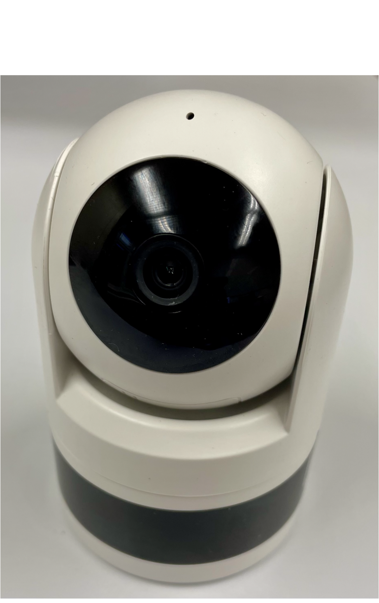
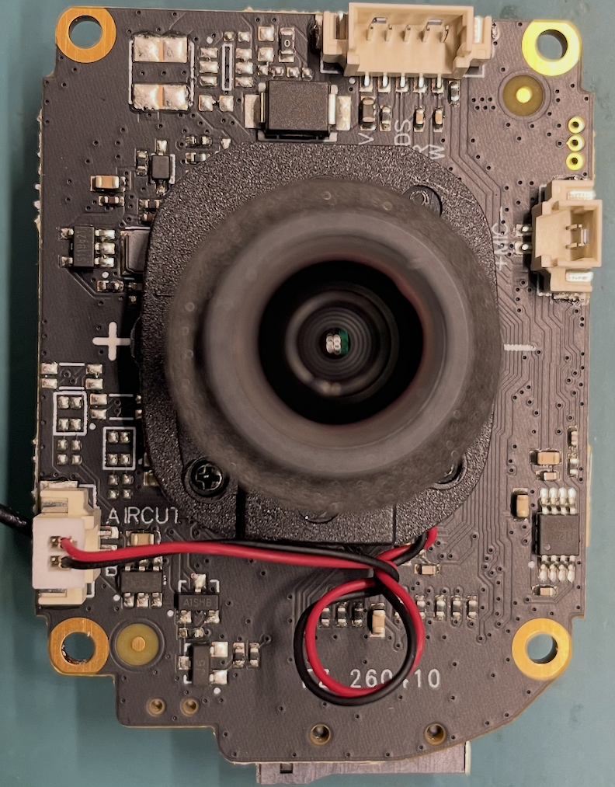
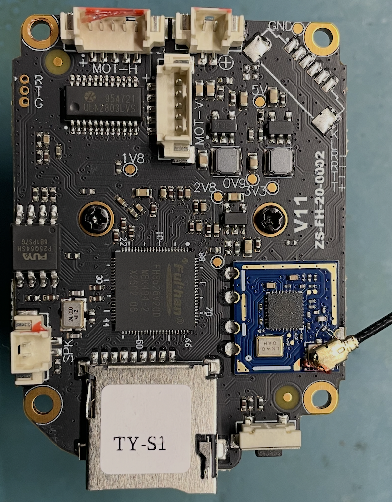
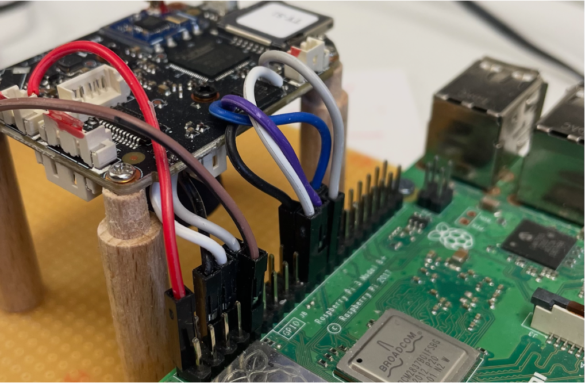
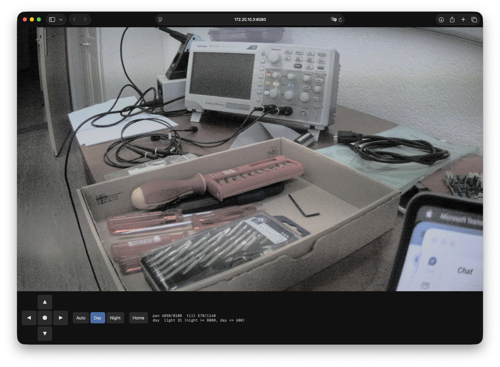

# Open firmware for an IoT camera, reverse-engineered with AI

A pan/tilt Wi-Fi camera built around the Fullhan **FH8626V200** SoC now runs a firmware
built only from upstream releases and our own code: U-Boot 2026.07, Linux 6.18 LTS,
BusyBox, and our own drivers for the camera pipeline, the motors and the IR equipment. The
vendor's stack consisted of binary kernel modules, an RTOS on a co-processor and closed
libraries. We replaced it, and the camera pipeline uses no vendor tuning data.

The reverse engineering was done by an AI coding agent (Claude Code), with a human
running the board experiments. This page describes what we found, how, and what is still
missing.

<!-- IMAGE: photo of the opened camera with the board, UART wires and SPI clip -->

<p float="left">
  
   
  
</p>


---

## Contents

1. [Why replace IoT firmware?](#why-replace-iot-firmware)
2. [The device](#the-device)
3. [Method](#method)
4. [Chronology of the bring-up](#chronology-of-the-bring-up)
   1. [First characters on the UART](#1-first-characters-on-the-uart)
   2. [Flash image format and boot ROM](#2-flash-image-format-and-boot-rom)
   3. [DDR bring-up](#3-ddr-bring-up)
   4. [Porting and loading U-Boot](#4-porting-and-loading-u-boot)
   5. [Porting the Linux kernel](#5-porting-the-linux-kernel)
   6. [Wireless driver](#6-wireless-driver)
5. [The camera](#the-camera)
6. [Motors, IR-cut, LEDs and key](#motors-ir-cut-leds-and-key)
7. [The resulting system](#the-resulting-system)
8. [Limitations](#limitations)
9. [Outlook](#outlook)
10. [Reproducing](#reproducing)
11. [Provenance and licences](#provenance-and-licences)

---

## Why replace IoT firmware?

- **Supply-chain control.** The firmware of a typical IoT camera is a closed bundle:
  an old vendor kernel, binary modules, an RTOS blob on a co-processor and a cloud
  application. Nobody outside the vendor can say what it contains. A firmware built
  from upstream sources and auditable patches can be checked line by line.
- **Validation.** Security and functional validation need maintained, documented
  software. A Linux 4.9 kernel (end of life since 2023) with out-of-tree binary modules cannot be patched or
  re-certified by the owner of the device.
- **Environment.** Devices that the manufacturer no longer supports are usually thrown
  away although the hardware still works. An open firmware on a current kernel keeps
  them in service, and keeps them secure.

The obstacle has always been effort. Every device family needs its own reverse
engineering of boot chain, memory controller, peripherals and media blocks, and there
are thousands of device families. That work did not scale with human experts. This
project tests whether an AI agent can do most of it, so that it might scale.

---

## The device

| Item         | Value                                                                                                                                    |
| ------------ | ---------------------------------------------------------------------------------------------------------------------------------------- |
| Product      | Indoor pan/tilt dome camera, Tuya cloud firmware                                                                                         |
| SoC          | Fullhan FH8626V200: one Arm Cortex-A7 (r0p5), ARC co-processor, ISP, VPU, JPEG and H.264/H.265 encoders                                  |
| Memory       | 64 MiB DRAM in the package, at 0xA0000000                                                                                                |
| Flash        | Puya P25Q64SH SPI NOR, 8 MiB (JEDEC ID 85 60 17)                                                                                         |
| Image sensor | SmartSens SC2336, 1920×1080, 2-lane MIPI CSI-2                                                                                           |
| Wi-Fi        | iComm SV6355 on internal USB (8065:6011)                                                                                                 |
| Actuators    | Two 4-coil stepper motors (pan, tilt), latching IR-cut filter, IR LEDs, white LED                                                        |
| Debug access | UART pads at 115200 baud; no JTAG. The flash can be reprogrammed with an external SPI programmer, so a bad image never bricks the board. |

### The vendor firmware

| Layer        | Vendor firmware                                                                                  |
| ------------ | ------------------------------------------------------------------------------------------------ |
| Boot loader  | Fullhan first stage, U-Boot 2010.06                                                              |
| Kernel       | Linux 4.9.129, board-file kernel without device tree                                             |
| Media        | 8 binary kernel modules (`vmm`, `xbus_rpc`, `media_process`, `isp`, `enc`, `jpeg`, `bgm`, `nna`) |
| Co-processor | RT-Thread image for the ARC core (encoder helper and audio DSP)                                  |
| Libraries    | About 20 closed user-space libraries (ISP, 3A, MIPI, DSP, audio)                                 |
| Application  | `sdk_app` media server with the sensor driver compiled in, plus the cloud application            |
| Tuning       | Binary ISP parameter files per sensor, day and night                                             |
| Motors       | `motor_gpio.ko`, a GPIO bit-banger with custom ioctls                                            |

The vendor kernel modules import symbols that only exist in the vendor kernel
(`fh_clk_*`, `fh_pmu_*`, `fh_gpio_set` and so on), so none of them can be loaded on a
current kernel.

---

## Method

### Tools

- **AI agent:** [Claude Code](https://claude.com/claude-code) with the **Claude Opus 5.5**
  model at the **medium** effort setting. The agent read and disassembled the binaries,
  wrote the emulator, the probes, the drivers and the documentation, and proposed every
  experiment.
- **Human in the loop:** a project lead flashed the images, ran the experiments on the
  board, measured with an oscilloscope where needed, and reported the console output
  and captured files back to the agent. Decisions on scope and licensing stayed with
  the human.
- **Static analysis:** disassembly of the stock first stage, U-Boot, kernel, modules
  and libraries (objdump, Ghidra). The modules are not stripped, which helped a lot.
- **Emulation:** the stock kernel modules and user-space libraries run in an ARM
  emulator ([Unicorn](https://www.unicorn-engine.org/)) with Python stubs for the
  kernel API and libc. Every access to the media registers is logged. This turned the
  vendor's bring-up into a complete register sequence without running the vendor stack
  on our kernel.
- **Probing on the board:** `devmem`, small static tools (`memcat`, `cam-probe`,
  `cam-grab`) and a bring-up kernel driver that services interrupts and exposes
  counters through sysfs.
- **Bisection on hardware:** the emulated vendor sequence (1,731 register writes) was
  replayed on our kernel and then cut down group by group until only the necessary
  writes were left. Those were then replaced by values we can explain.

### Working rules

1. **Every fact gets a source.** Each register value and address in the project is
   labelled with where it came from:

   | Class | Origin                                                                    |
   | ----- | ------------------------------------------------------------------------- |
   | A     | Observed on the board (register reads, logs, scope traces)                |
   | B     | Analysis of the stock firmware (disassembly, emulation, image layout)     |
   | C     | Public GPL source (OpenIPC Fullhan kernel patch, Rockchip SC2336 driver)  |
   | D     | Other open projects, used only to compare register patterns               |
   | E     | Our own design and code                                                   |
   | F     | General knowledge of the AI; never accepted as the only source of a value |

   A claim that could not be sourced was downgraded or withdrawn.

2. **No vendor code or vendor tuning data in the result.** Stock binaries are analysed,
   never redistributed or linked. The one exception is the DDR training script (see
   [DDR bring-up](#3-ddr-bring-up)).
3. **Upstream plus patches.** No upstream source lives in the repository: pinned release
   tarballs, verified by SHA-256, plus our patch series on top.
4. **Short board sessions.** The agent prepared complete, self-contained shell blocks.
   The human ran them and pasted the output back. One session usually answered several
   questions at once.




Lab setup with the camera's UART and SPI-Flash-Chip directly connected to a Raspberry Pi 3B as means to
access the console and update the flash.

---

## Chronology of the bring-up

### 1. First characters on the UART

The first goal was to run any code of our own. Our loader was a bare-metal program
that the boot ROM copies into on-chip SRAM at 0x10008000.

- The UART is a 16550-compatible DesignWare APB UART at 0xF0700000 (register shift 2).
  The boot ROM already configures it for 115200 8N1, so the first program only
  writes characters into the transmit register and polls the status bit.
- `start.S` prints a `0` before any C code, mode switch or stack setup. That proves the
  CPU reached our code. Then `1` (C environment works), up to `Hello World`.
- A minimal exception vector table (VBAR) reports data aborts with LR, FSR and FAR
  instead of hanging. This was the only debug channel without JTAG.

<!-- IMAGE: first UART log with "Use nor flash.", checkpoint digits and "Hello World" -->


### 2. Flash image format and boot ROM

The boot ROM only starts code from a flash image with the right structure. That format
was recovered from the stock flash dump and rebuilt by our own Python image builder.

| Offset          | Content                                                                      |
| --------------- | ---------------------------------------------------------------------------- |
| 0x000           | Header, magic `2BL*OABD`, sync pattern 0xAA5555AA; bytes 0x28–0xFF stay 0xFF |
| 0x100           | Section table, 64-byte entries (name, load and exec address, size, checksum) |
| 0x1000          | `DDR_0` section: DRAM controller script, 249 records of 16 bytes             |
| 0x4000 / 0x8000 | Code sections (`ram`, `uboot`)                                               |

The **checksum** is `zlib.crc32(section padded with zeros) ^ 0xFFFFFFFF`, which is the
CRC register before the final XOR. It was found by testing candidate algorithms against
the known-good pairs in the stock image.

Boot ROM error codes, decoded from experiments:

| Code       | Meaning                                                                   |
| ---------- | ------------------------------------------------------------------------- |
| `ERR: 209` | A required section is missing (seen without `DDR_0`)                      |
| `ERR: 216` | Section checksum does not match its content, printed once per bad section |

### 3. DDR bring-up

The DRAM is trained by the **boot ROM itself**, from the `DDR_0` script in the flash
image. Each record holds address, value, mask and a tag: poll, write, write plus delay,
or block-end write.

What it took:

- Our first rebuilt `DDR_0` section was structurally valid but the boot ROM ignored it.
  Flashing only the first 16 KiB of the stock image produced
  `ROM: Init DDR..Training done.` for the first time, and a byte-by-byte comparison
  then showed the differences:
  - The `DDR_0` table entry uses its own field convention, with a type marker 0x78503
    that the boot ROM checks.
  - Its padded size is 0x1080 bytes, not the generic rounding of the other sections.
- With both fixed, our own image trained the DRAM.
- Replaying the same script a second time from our loader **hard-reset** the board.
  The controller is already live after the boot ROM, so the replay was removed. The
  loader only runs a DRAM write/read-back test at 0xA0000000.

The 249 records are vendor data copied from the stock image. Their meaning is only
partly understood:

| Records    | Meaning                                                       |
| ---------- | ------------------------------------------------------------- |
| 0          | Confirmed                                                     |
| 98 (39 %)  | Structural: the pattern matches public DDR controller drivers |
| 11 (4 %)   | Our own analysis only                                         |
| 140 (56 %) | Unknown                                                       |

The script works as an opaque table. It is the only vendor-derived data in the flash
image.

### 4. Porting and loading U-Boot

The loader then grew into a second stage that loads U-Boot.

- **SPI NOR.** The flash controller is a DesignWare SSI at 0xF0500000 with two
  vendor wrapper registers (+0xF4 CCFGR, +0xF8 OPCR). Chip select needs **two** signals:
  bit 0 of the SER register and GPIO0 bit 6 driven low. This was found with an
  oscilloscope after the disassembly of the stock first stage gave the candidate
  registers. The public OpenIPC kernel patch later confirmed the register names.
- **U-Boot 2026.07** board port (10 patches): a `fh8626` board, the 16550 UART, the
  upstream DesignWare SPI driver with the extra chip-select GPIO. It reports
  `CPU: FH8626, chip id 0x20102801` and `DRAM: 64 MiB`. U-Boot is linked for 0xA0000000,
  where the loader places it.
- **CPU probe from U-Boot:** Cortex-A7 r0p5, a standard Arm GIC at CBAR 0x30000000, and a
  24 MHz generic timer whose frequency register reads 0. This decided the kernel port:
  the FH8626V200 is a plain ARMv7 multiplatform machine, not one of the older Fullhan
  chips with an ARM1176 core and a custom interrupt controller.
- **Booting the kernel.** `bootz` needed `CONFIG_SUPPORT_PASSING_ATAGS` and a boot-parameter
  address of 0xA0000100 because the kernel carries its own appended device tree. The
  final boot command is `sf probe 0:0; sf read 0xA1000000 0x80000 0x600000; bootz 0xA1000000`.
- **Rule:** a kernel is not booted without comparing its CRC32 in RAM with the host.
  A rebuilt kernel often has the same size, so a stale flashed copy looks plausible.
  The check caught exactly that once.

### 5. Porting the Linux kernel

The first kernel was the stock version, 4.9.129, plus the public OpenIPC Fullhan patch.
It reached a BusyBox shell. We then moved to **Linux 6.18.56 LTS without any vendor
patch**: the SoC needs only standard drivers, and the 4.9 patch targets other chips.

| Part             | How                                                                                               |
| ---------------- | ------------------------------------------------------------------------------------------------- |
| Machine          | ARMv7 multiplatform, device tree only (no board file)                                             |
| Interrupts       | Standard GIC; SoC interrupt _n_ is `GIC_SPI n` (stock ID − 32)                                    |
| Timer            | Arm arch timer, frequency from the device tree because CNTFRQ reads 0                             |
| UART             | `snps,dw-apb-uart`, 16.667 MHz clock                                                              |
| GPIO             | `snps,dw-apb-gpio`, two banks of 32                                                               |
| Pinmux           | `pinctrl-single` on the pad registers (PMU + 0x80 + 4 × pad)                                      |
| Clocks           | New PMU clock driver (mux, divider, gate, PLLs), decoded from the stock clock table of 70 entries |
| I2C              | `snps,designware-i2c` (component 1.21a), found to be DesignWare by reading its ID register        |
| USB              | DWC2 host plus a new small USB PHY driver; VBUS switched by GPIO47                                |
| Root file system | Static BusyBox 1.37.0 in an initramfs inside the kernel image                                     |

The pad multiplexing table did not exist in any public source. It was decoded from the
pin table in the stock boot loader: entries `{name, 0, packed}` with pad in bits 7:0,
register offset in bits 15:8 and function in bits 23:20.

**Peripheral map** (from the stock kernel's resource tables, interrupts confirmed on the
board where noted):

| Block                           | Base                                 | `GIC_SPI`      |
| ------------------------------- | ------------------------------------ | -------------- |
| PMU (clocks, resets, pads)      | 0xF0000000                           |                |
| I2C0 (sensor)                   | 0xF0200000                           | 11 (confirmed) |
| GPIO bank 0 / 1                 | 0xF0300000 / 0xF4000000              | 26 / 40        |
| SPI0 (flash)                    | 0xF0500000                           | 28             |
| UART0                           | 0xF0700000                           | 30 (confirmed) |
| MIPI wrap / CSI-2 host / D-PHY  | 0xF1000000 / 0xF1100000 / 0xF1700000 | 18 (wrap)      |
| USB (DWC2)                      | 0xE0700000                           | 39             |
| JPEG encoder                    | 0xE8300000                           | 13 (confirmed) |
| ISP and VPU                     | 0xE8400000 (1 MiB)                   | 7 (confirmed)  |
| GIC distributor / CPU interface | 0x30001000 / 0x30002000              |                |

### 6. Wireless driver

The Wi-Fi module is an iComm SV6355 on the internal USB port.

- VBUS for the port is switched by GPIO47; the device appears as 8065:6011.
- The driver is the open-source **ssv6x5x** driver of the Wi-Fi chip maker (iComm),
  published through OpenIPC. It is vendor code, but not from the camera vendor, and it
  comes with its own matching firmware. Nothing from the camera's stock image is used.
- Three small patches port it to Linux 6.18: the kbuild flags, the new cfg80211 callback
  signatures, and renamed kernel helpers (44 lines in total).
- The driver keeps the kernel's world regulatory domain; the stock RF tuning is not
  carried over.
- The board boots straight into Wi-Fi: `wpa_supplicant` plus DHCP from `/init`.

---

## The camera

The camera path was the largest part of the work. In the stock firmware it is spread
over five kernel modules, the ARC firmware, several libraries and the media server.

```
SC2336 ──MIPI 2 lanes──▶ CSI-2 host ─▶ MIPI wrap ─▶ ISP ─▶ VPU channel 0 ─▶ DDR (NV12)
   ▲ I2C0, MCLK 24 MHz                                                      │
   └──── exposure/gain (AE) ◀── statistics from the frame ◀─────────────────┤
                                                                            ▼
                                                        JPEG encoder ─▶ MJPEG buffer
```

<!-- IMAGE: block diagram of the pipeline with register bases -->


### Step 1: sensor on I2C

- I2C0 needed the pinmux (pads 5/6 to function 0), its clock gate open and a correct
  clock: the controller runs at 50 MHz, not the 100 MHz first assumed.
- PMU clock gates: **a set bit switches the clock off**. The sensor clock was off after
  reset.
- With MCLK at 24 MHz and reset (GPIO13) released, the sensor answers at address 0x30
  with chip ID **0xCB3A** (SC2336).
- The sensor driver (mode table and controls) is based on the GPL Rockchip SC2336
  driver: 1920×1080 RAW10, 30 fps, 2 lanes at 405 Mbit/s. Its line and frame lengths
  (HTS 4500, VTS 1200) match the header of the stock tuning files.

### Step 2: MIPI CSI-2 receiver

The receiver is a **Synopsys DesignWare CSI-2 host 1.30a** (VERSION reads 0x3133302A),
with a Fullhan D-PHY block and a "wrap" block that connects it to the ISP.

| Block      | Register              | Value / meaning                                   |
| ---------- | --------------------- | ------------------------------------------------- |
| CSI-2 host | +0x04 N_LANES         | lanes − 1                                         |
|            | +0x08 / +0x40 / +0x44 | CSI2_RESETN, PHY_SHUTDOWNZ, DPHY_RSTZ             |
|            | +0x4C PHY_STOPSTATE   | data lanes 0/1 toggle per line: link up           |
|            | +0xE0…+0x130          | six error status registers, all 0: clean link     |
| D-PHY      | +0x28                 | frequency code per lane (0x08 for 300–499 Mbit/s) |
| Wrap       | +0x00                 | 0x04800004 for the SC2336 setting                 |

### Step 3: ISP and VPU, the hard part

The ISP and the VPU (scaler and DMA output) share one 1 MiB register block at 0xE8400000.
Reconstructing their setup by hand from the disassembly stalled: interrupts came, but the
VPU wrote only 128 bytes per frame. The way forward was **emulation**.

- The stock `media_process.ko`, `isp.ko` and the ISP libraries were run in the Unicorn
  emulator, following the call sequence of the vendor media server. The result is the
  complete vendor bring-up as **1,731 register writes** in 75 groups.
- Replaying that list on our kernel gave frame interrupts, but at first only 754 of
  1,080 lines. With the sensor's test pattern the cause was visible: the ISP lost 532
  pixels per line because `isp_aclk` ran at 50 MHz. At 100 MHz the frame was complete.
- Then **bisection on the board** reduced the list: skip groups, compare the picture
  (test pattern and real scene), keep only what changes it. 1,731 → 1,105 writes. The
  remaining values were then replaced, one block at a time, by values we compute or
  can explain:

| Block                          | Finding                                                                   | Our value               |
| ------------------------------ | ------------------------------------------------------------------------- | ----------------------- |
| Interrupt enable +0x08         | Needed for frame interrupts                                               | 0x07FFFFFF              |
| Input +0x28                    | Bayer phase in bits 3–4, plus bits 9 and 12                               | 0x1210                  |
| Black level +0x13C/+0x140      | Without it the picture is grey and flat                                   | 0x42 per channel        |
| Tone tables +0x1A40…+0x1E00    | Four 160-entry curves                                                     | Linear                  |
| White balance +0x570/+0x574    | B, G, G, R gains, 0x200 = 1.0                                             | From AWB                |
| DRC +0x590                     | Must be written **before** the start, 0 stalls the pipeline               | 0x0D                    |
| Colour gain +0x600             | 0 = grey, ≥ 0x1FF false colour                                            | 0x100                   |
| Gamma +0x690…+0x890            | 256 × 16 bit                                                              | Our curve x^1.7         |
| Contrast +0xE00, chroma +0xE0C | Bits 0/8 of +0xE0C switch chroma off                                      | 0x40, 0x00010000        |
| Scaler coefficients +0x1F40…   | Needed even at 1:1 (white lines without)                                  | Our identity filter     |
| VPU channels 1/2               | Unused, but need a valid size and step **while enabled** before the start | 640×360, computed steps |
| VPU channel 0                  | 1920×1088 NV12, step 1080 → 1088 lines                                    | Computed                |

The final list has **1,044 writes, all computed from the frame geometry or found by the
bisection, with no vendor tuning table**.

<!-- IMAGE: progression of frames: 754-line stripes, overexposed grey, first colour, final image -->


Key findings about the ISP interrupt (status +0x04, enable +0x08, `GIC_SPI 7`):

| Bit | Event                                       |
| --- | ------------------------------------------- |
| 17  | ISPF START                                  |
| 16  | ISPP START                                  |
| 1   | ISPF END: frame written, used by the driver |
| 0   | ISPP END                                    |
| 3   | Pipe conflict                               |

Switching the VPU channel off and on for every frame, as the vendor driver does, breaks
the luma path. Our driver leaves the channel on and only rewrites the two buffer
addresses (+0x1350, +0x1354) at ISPF END; the next frame then goes to the new buffer.

### Step 4: the kernel driver

`fh8626-camera` is a V4L2 capture driver of about 1,800 lines:

- Device tree graph: SC2336 → camera node; 16 MiB reserved buffer pool at 0xA3000000.
- Formats: NV12 1920×1088 and **MJPEG**.
- **Auto exposure:** mean luma from a 32×18 grid sampled on every third frame. It sets
  sensor exposure and gain with a damped square-root step, keeps exposure times at
  multiples of 10 ms (no flicker under 50 Hz light), and raises gain only above the
  longest exposure, up to 16×.
- **Auto white balance:** gray world on near-gray points, applied directly in the ISP
  from the interrupt.
- **Saturation control** for monochrome night mode.
- 30.00 fps, no dropped frames.

### Step 5: the JPEG encoder

The JPEG unit at 0xE8300000 (ID 0x00038401) was decoded from `jpeg.ko`.

| Offset        | Content                                         |
| ------------- | ----------------------------------------------- |
| +0x04         | Status, bit 0 = done (write 1 to clear)         |
| +0x0C         | Output length in bytes                          |
| +0x10         | 0x80000001 = start                              |
| +0x14 / +0x1C | Height and width fields                         |
| +0x34 / +0x38 | Output address                                  |
| +0x3C / +0x40 | Input Y / C address                             |
| +0x44         | Macroblock count (h/16 − 1) << 16 \| (w/16 − 1) |
| +0x58         | Width, format code (2 = linear NV12)            |
| +0x64         | Burst (7 for width % 64 = 0)                    |
| +0x6C / +0x70 | Reset                                           |
| +0x80…+0xFC   | Quantisation tables (zigzag)                    |
| +0x100…+0x3FC | Huffman encoder table                           |
| +0x400…+0x598 | DHT payload                                     |

- All tables are the standard ones from ITU-T T.81 Annex K. We compute them ourselves;
  they are byte-identical to the vendor's.
- The hardware writes a complete JFIF stream (SOI to EOI).
- The format code was found by testing: code 0 is the VPU's tile layout (picture
  scrambled in 16×16 blocks), code 2 is linear NV12.
- The encoder needs less than 1 ms per frame; MJPEG runs at 30 fps:

| Quality | Frame size | Bit rate at 30 fps |
| ------- | ---------- | ------------------ |
| 50      | 205 KB     | 49 Mbit/s          |
| 75      | 330–360 KB | 79 Mbit/s          |
| 90      | 696 KB     | 167 Mbit/s         |

For Wi-Fi the HTTP server sends 10 fps at quality 60 by default.

<!-- IMAGE: a full-resolution MJPEG frame from the camera -->



---

## Motors, IR-cut, LEDs and key

The GPIO numbers came from the stock `hardware.txt`; the pads from the decoded pin table.
Every line was first checked on the board with `devmem`.

| Element                              | GPIO           | Pad     | Driver and interface                             |
| ------------------------------------ | -------------- | ------- | ------------------------------------------------ |
| Pan motor, coils 1–4                 | 0–3            | 20–23   | `gpio-stepper`, `/sys/class/stepper/pan/`        |
| Tilt motor, coils 1–4                | 37, 38, 41, 42 | 13–16   | `gpio-stepper`, `/sys/class/stepper/tilt/`       |
| IR-cut filter in (day) / out (night) | 4 / 43         | 24 / 18 | `gpio-ircut`, `/sys/devices/platform/ircut/mode` |
| White LED / IR LED                   | 39 / 40        | 11 / 12 | `gpio-leds`, `/sys/class/leds/{white,ir}/`       |
| Reset key                            | 44             | 19      | `gpio-keys`, `KEY_RESTART`                       |
| Light sensor                         | 26             | 38      | Not fitted on this board                         |

- **Stepper driver.** It half-steps from an hrtimer with a speed ramp, and switches the
  coils off when idle. Stepping from a user-space shell loop was rough because the step
  timing was uneven.
- **Ranges.** Pan has 8,100 half-steps at 900 per second, tilt 1,140 at 600 (the stock
  values).
- **Day/night without a light sensor.** The brightness measure is exposure × gain from
  the auto exposure, with hysteresis and hold times. Night mode means filter out, IR LED
  on, grey picture. In night mode the IR LED lights the scene, so a flapping guard halves
  the day threshold when the camera falls back to night too soon.
- **Web page.** The HTTP server's page has a hold-to-move pan/tilt pad.

<!-- IMAGE: screenshot of the web page with stream, pan/tilt pad and day/night buttons -->


<!-- IMAGE: night-mode frame with IR illumination -->


---

## The resulting system

### Boot sequence

| #   | Stage                | Runs from       | Does                                                                                                       |
| --- | -------------------- | --------------- | ---------------------------------------------------------------------------------------------------------- |
| 1   | Boot ROM (mask ROM)  | ROM             | Checks the image, trains DRAM from `DDR_0`, prints `ROM: Init DDR..Training done.`, copies stage 2 to SRAM |
| 2   | Our 2nd-stage loader | SRAM 0x10008000 | SPI NOR setup, reads U-Boot to DRAM 0xA0000000                                                             |
| 3   | U-Boot 2026.07       | DRAM 0xA0000000 | Reads the kernel blob (0x80000, 6 MiB) to 0xA1000000, `bootz`                                              |
| 4   | Linux 6.18.56        | DRAM            | zImage with appended device tree and built-in initramfs                                                    |
| 5   | `/init` (BusyBox)    | initramfs       | Mounts `/proc`, `/sys`, `/dev`; starts Wi-Fi and `/etc/init.d/rcS`                                         |
| 6   | `rcS`                |                 | Starts `cam-http`, homes and centres the pan/tilt head                                                     |

<!-- IMAGE: complete boot log from the boot ROM to the shell -->


### Flash layout (8 MiB)

| Offset   | Size    | Content                                                          |
| -------- | ------- | ---------------------------------------------------------------- |
| 0x000000 | 32 KiB  | Image header, section table, `DDR_0` script, 2nd-stage loader    |
| 0x008000 | 384 KiB | U-Boot                                                           |
| 0x070000 | 64 KiB  | Reserved for the U-Boot environment                              |
| 0x080000 | 6 MiB   | Kernel blob: zImage, device tree, initramfs (about 6.04 MB used) |
| 0x680000 | 1.5 MiB | Free                                                             |

The image builder checks every part against its slot, so an oversized part fails the
build instead of overwriting its neighbour.

### Memory map (64 MiB DRAM)

| Range                 | Use                                                                       |
| --------------------- | ------------------------------------------------------------------------- |
| 0xA0000000–0xA2FFFFFF | Linux (48 MiB)                                                            |
| 0xA1000000            | Kernel blob load address during boot                                      |
| 0xA3000000–0xA3FFFFFF | Camera buffer pool (16 MiB, `no-map` DMA pool): NV12 frames, JPEG buffers |

### Vendor firmware compared with ours

| Component       | Vendor firmware                                                | Our firmware                                                        |
| --------------- | -------------------------------------------------------------- | ------------------------------------------------------------------- |
| Boot loader     | U-Boot 2010.06                                                 | Own 2nd stage + U-Boot 2026.07 (10 patches)                         |
| Kernel          | Linux 4.9.129, board file                                      | Linux 6.18.56 LTS, device tree (31 patches)                         |
| Camera          | 8 binary modules, ARC RTOS, ~20 closed libraries, media server | One V4L2 driver with AE, AWB and MJPEG at 30 fps                    |
| ISP tuning      | Vendor parameter files                                         | 1,044 register writes of our own, no vendor data                    |
| Motors, IR      | Binary module, custom ioctls                                   | sysfs, `gpio-leds`, `gpio-keys`                                     |
| Wi-Fi           | Vendor module and firmware from the stock image                | Open ssv6x5x driver of the chip maker, ported to 6.18               |
| Application     | Closed media server and cloud app                              | BusyBox, HTTP MJPEG server with pan/tilt and day/night              |
| Code of our own |                                                                | About 4,100 lines of kernel drivers, plus loader, tools and scripts |

---

## Limitations

- **One device.** Everything was done on one board of one hardware revision.
- **Proof of concept.** The system works for streaming and control, but it is not a
  product.
- **No H.264/H.265.** The video encoder depends on the ARC co-processor, whose RTOS
  firmware generates the encoder's per-block information. That would mean
  reverse-engineering the ARC firmware as well.
- **No audio.** Microphone, speaker and the audio DSP on the ARC are not done.
- **Basic application.** MJPEG over HTTP only: no recording, motion detection, RTSP or
  ONVIF.
- **Unknown bits.** Most of the DDR script and some ISP line-buffer settings are used
  without being fully understood. The noise reduction blocks are not used, so MJPEG
  frames are larger than necessary.
- **Human in the loop.** Every experiment on the board needed a person to flash, run
  and report.

---

## Outlook

The human's job in this project was mechanical: flash an image, power-cycle, paste a
shell block, read the console, look at a picture, listen for a motor. All of that can be
automated with **hardware in the loop**:

- a SPI flash programmer and a power switch under the agent's control;
- the serial console connected to the agent;
- a reference scene and a second camera to judge pictures, motor positions and LEDs;
- a microphone and simple sensors for clicks, motion and light.

With that, the loop of analysis, experiment and observation could run without human
intervention, and reverse engineering could scale to many device families. The next
technical steps on this device are H.264 through the ARC, audio, noise reduction and
720p scaling.

---

## Reproducing

You need a Linux host with git, make, Python 3, `arm-none-eabi-gcc`,
`arm-linux-gnueabi-gcc`, the usual kernel build dependencies, and flashrom with a SPI
programmer.

```sh
make fetch     # download the pinned tarballs, check SHA-256
make prepare   # unpack into work/, apply the patch series
make           # loader + U-Boot + kernel + initramfs -> flash_image.bin
make flash     # write the image with flashrom
```

Connect the UART at 115200 baud and power the board. It boots to a shell, joins Wi-Fi
(with `.env/wpa_supplicant.conf` present at build time) and serves the camera at
`http://<board>:8080/`.

---

## Provenance and licences

| Component                                     | Licence                                | In the repository?                                                       |
| --------------------------------------------- | -------------------------------------- | ------------------------------------------------------------------------ |
| Linux 6.18.56, U-Boot 2026.07, BusyBox 1.37.0 | GPL-2.0                                | No, pinned tarballs plus our patches                                     |
| Our kernel and U-Boot patches                 | GPL-2.0                                | Yes                                                                      |
| ssv6x5x Wi-Fi driver (OpenIPC)                | Dual BSD/GPL, no licence file upstream | No, fetched plus our patches                                             |
| SC2336 mode table                             | GPL-2.0 (Rockchip)                     | Yes, inside our driver patch                                             |
| Stock firmware                                | Vendor, not licensed to us             | No. Analysed only                                                        |
| `DDR_0` training script                       | Vendor data from the stock image       | Yes, in the image builder. No code, just register values for DDR timing. |

More detail on each step is in the project notes: [bring-up](Initial_Bringup_Linux_to_Shell.md),
[camera](CAM.md), [Wi-Fi](WIFI.md), [I/O](IO.md).

<!-- IMAGE FILES TO ADD (docs/images/):
     camera-board.jpg, board-annotated.jpg, workflow-loop.png, uart-first-characters.png,
     camera-pipeline.png, camera-progression.jpg, mjpeg-frame.jpg, web-ui.png,
     night-mode.jpg, boot-log.png -->
